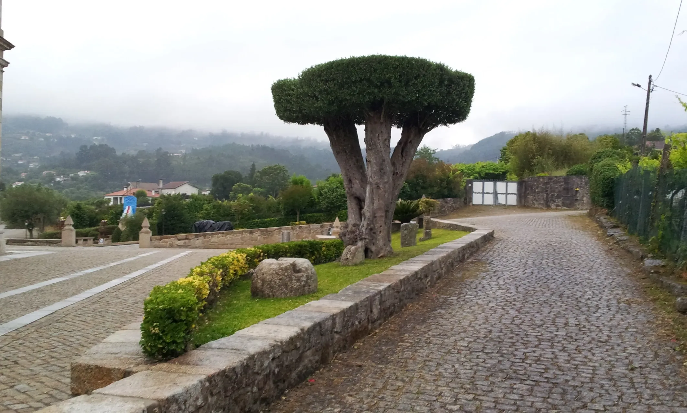
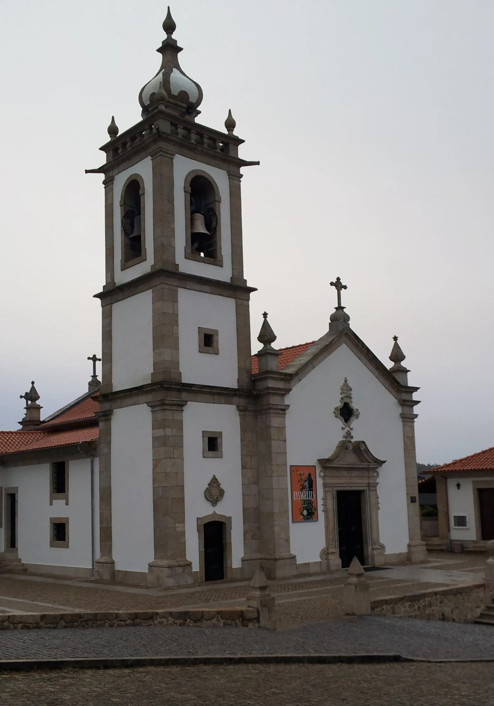
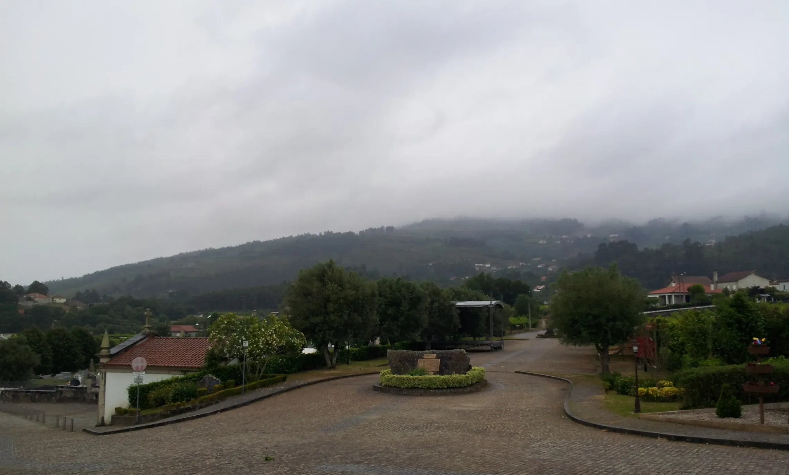
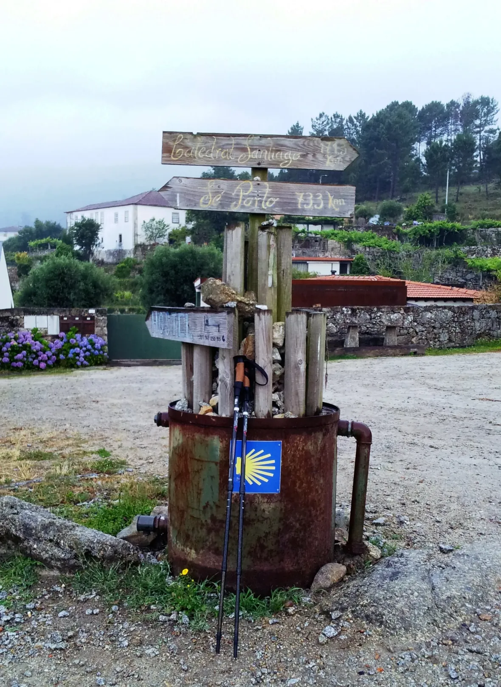
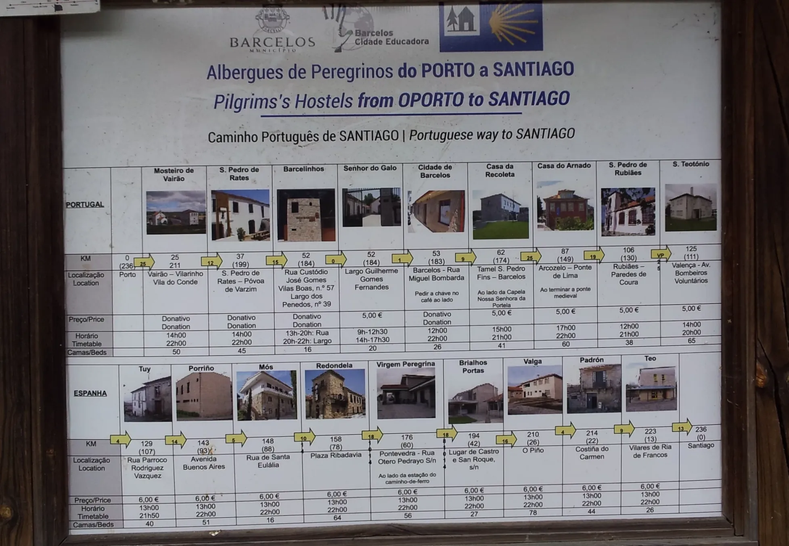
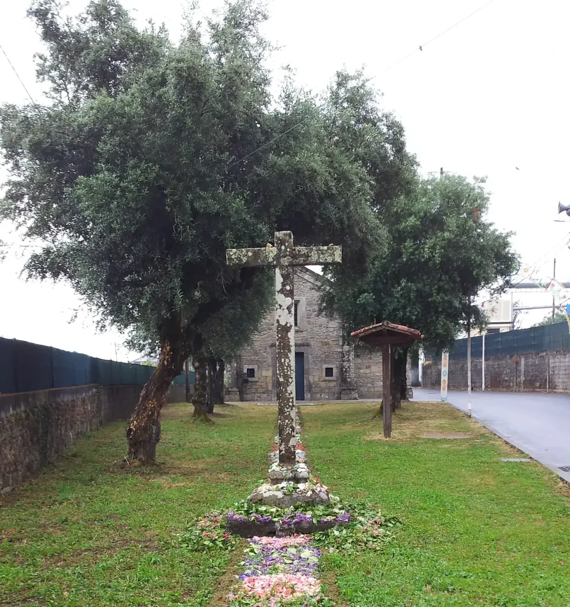
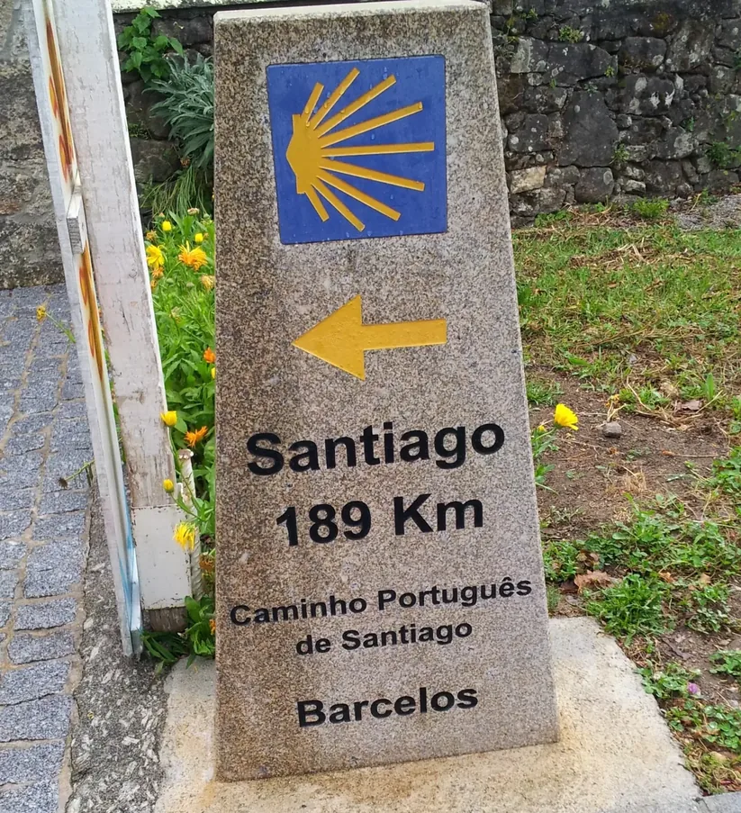
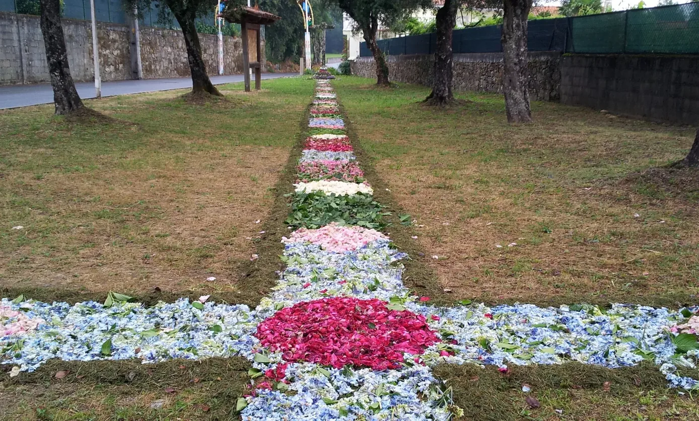

## Santiago de Compostela 👣 → Fátima 2019

### Etappe-06:  Vitorino dos Piães → São Pedro de Rates  ( 38,4 Km)
**18 Juni 2019** 👣  

---

  

🗺️

 🇬🇧 🇪🇸 🇵🇹 🇩🇪 🥾

---

↪ [Etappe-07_Sao-Pedro-de-Rates_Porto](Etappe-07_Sao-Pedro-de-Rates_Porto.md)

🔁  [Caminho-de-Fatima_Etapas](Camino-del-Salvador/Caminhos-de-Fatima/2_Santiago_Fatima_2019/Caminho-de-Fatima_Etapas.md)

 ...→