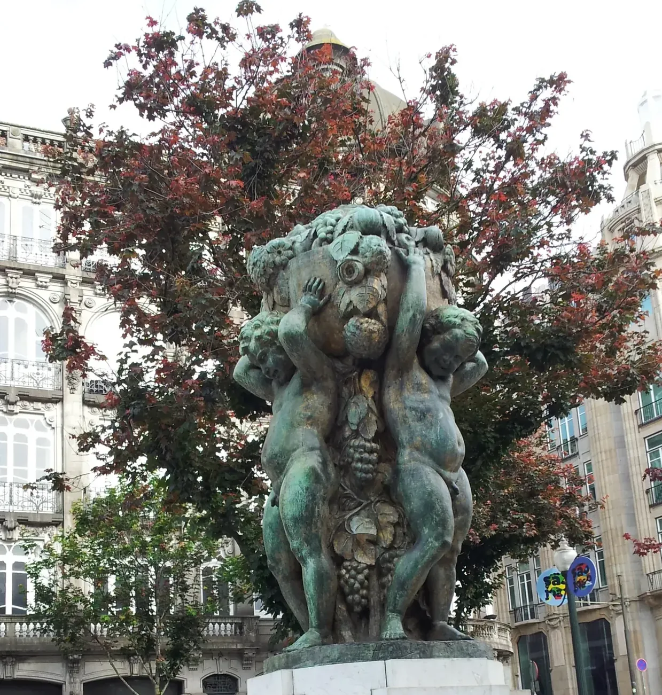
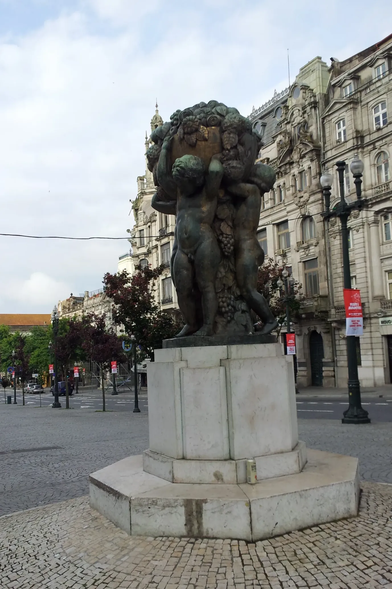
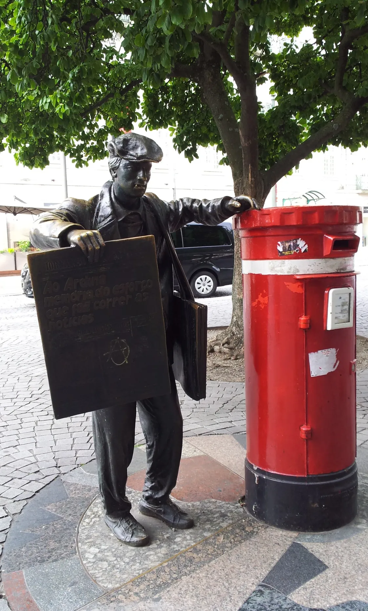
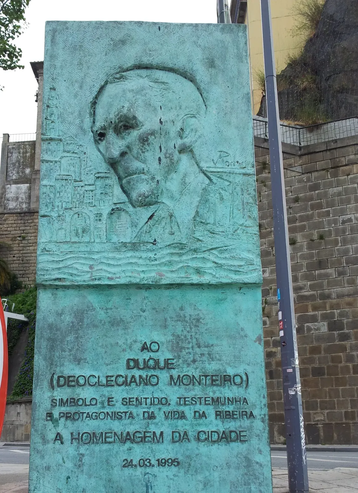
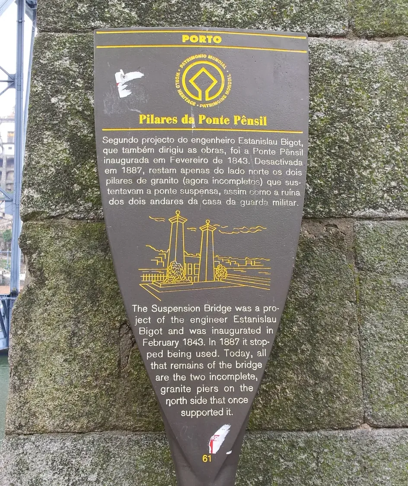
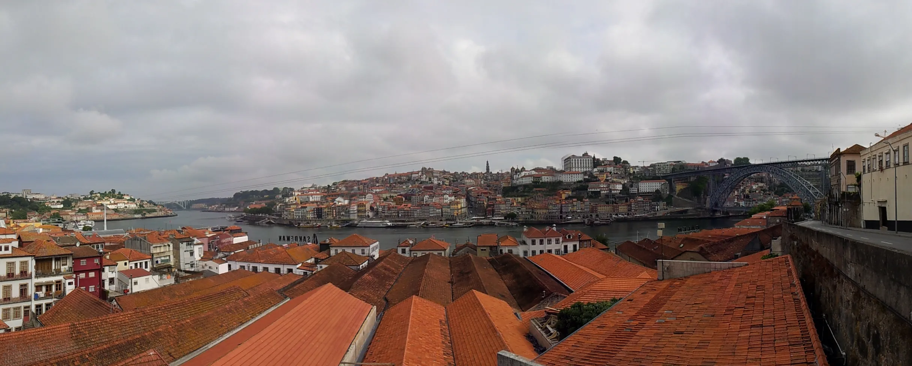
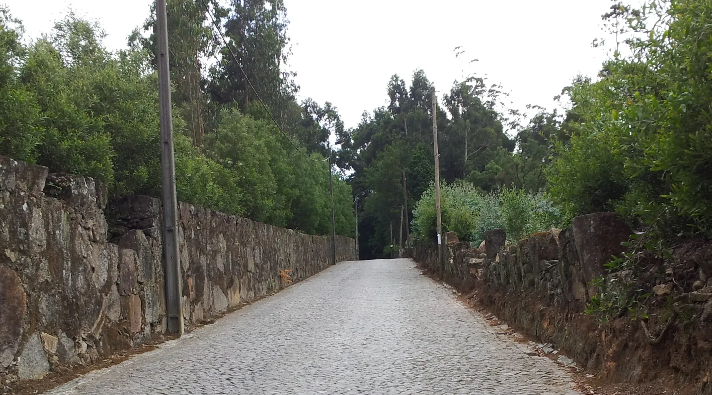
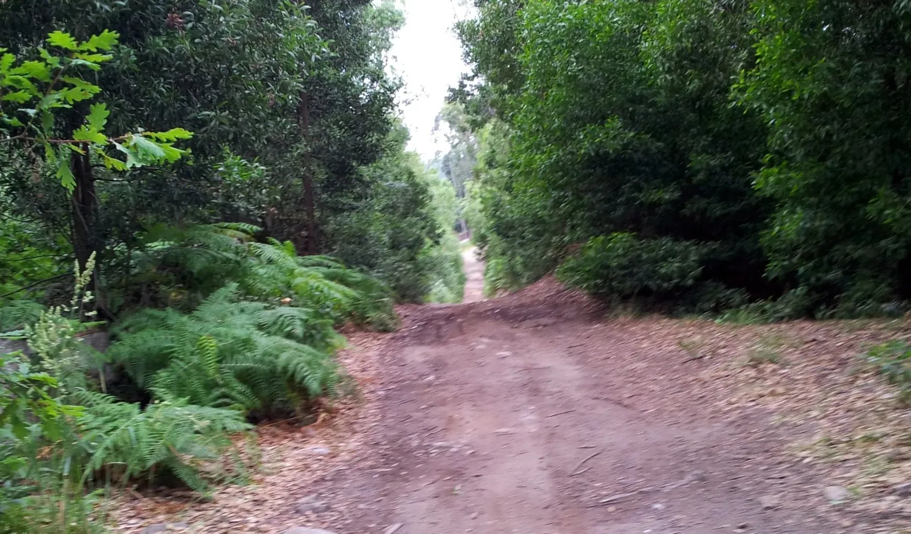
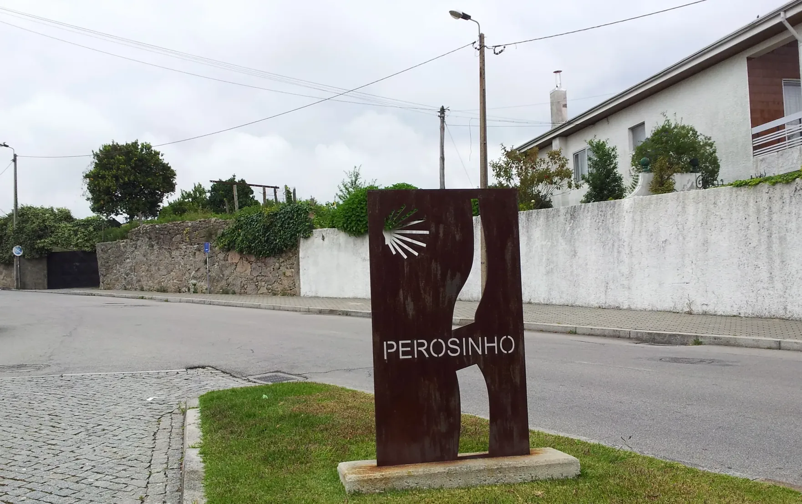
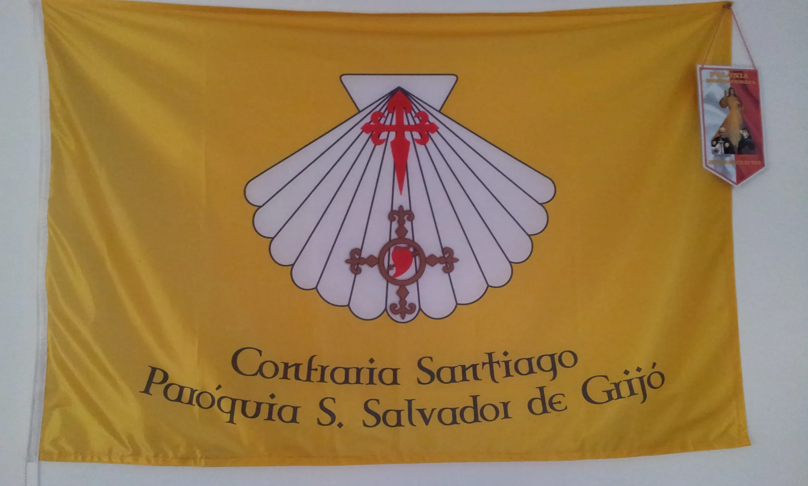

## Camino Santiago de Compostela 👣 → Fátima 2019

### Etappe-06: Porto → Grijó ( 15,1 Km)
**20 Juni 2019** 👣  

..., ... .
Não estava no plano parar, foi uma das surpresas mais agradâveis do Caminho  
e não esquecer de narrar a historia dos 100 peregrinos velhos e jovens  com cavalos e carro$a de Andaluzia que param em Campobecerros. ..., ... .

---

  

🗺️

 🇬🇧 🇪🇸 🇵🇹 🇩🇪 🥾

---

↪ [Etappe-09_Grijo_Branca-Alb-a-Velha](Etappe-09_Grijo_Branca-Alb-a-Velha.md)

🔁  [Caminho-de-Fatima_Etapas](Caminho-de-Fatima_Etapas.md)

 ...→