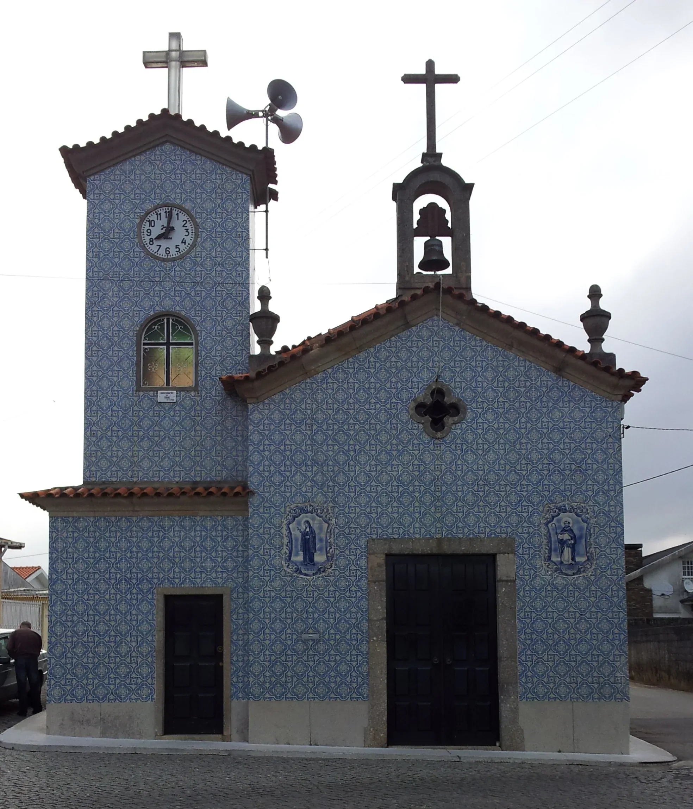
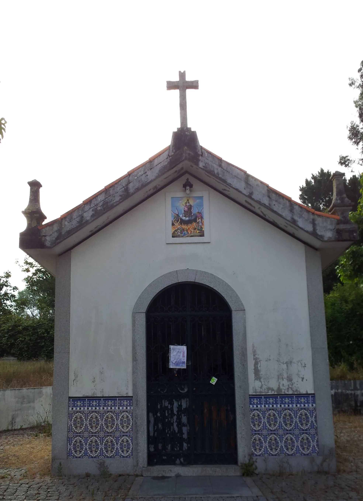
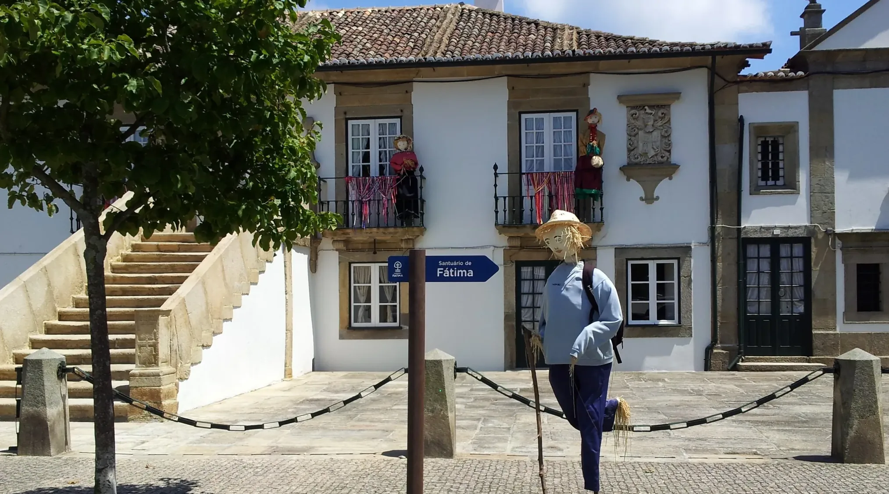
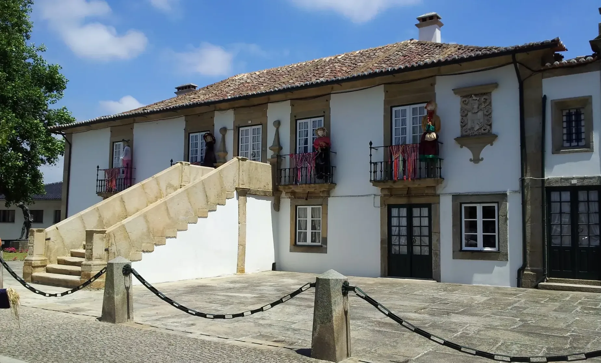
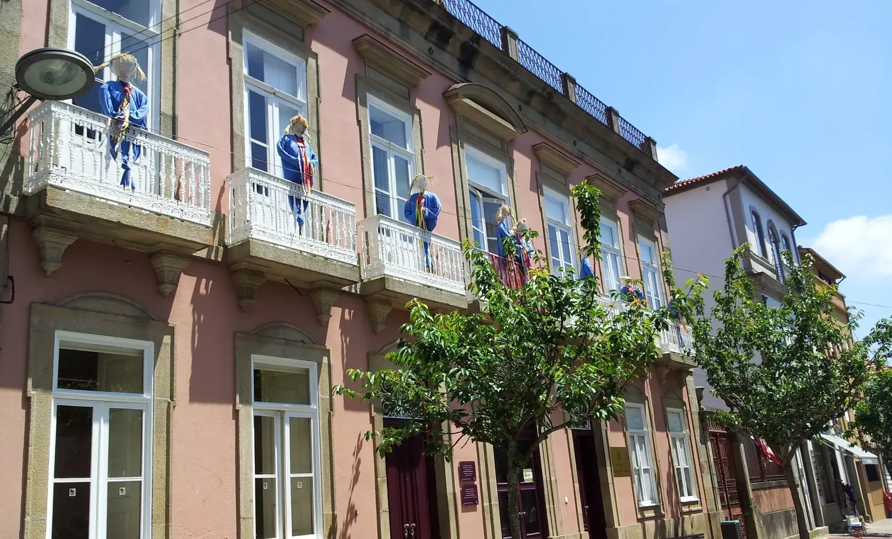
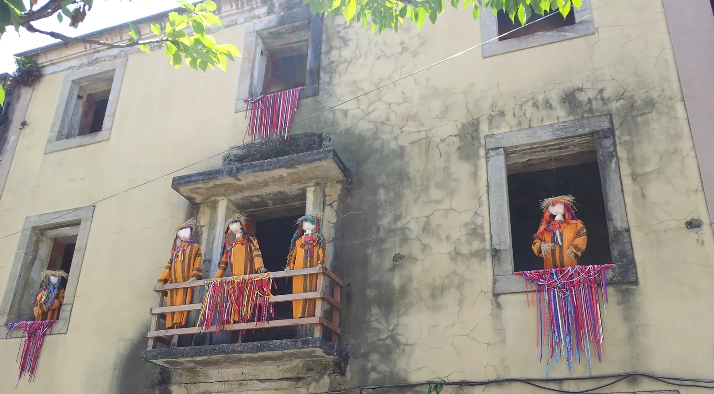
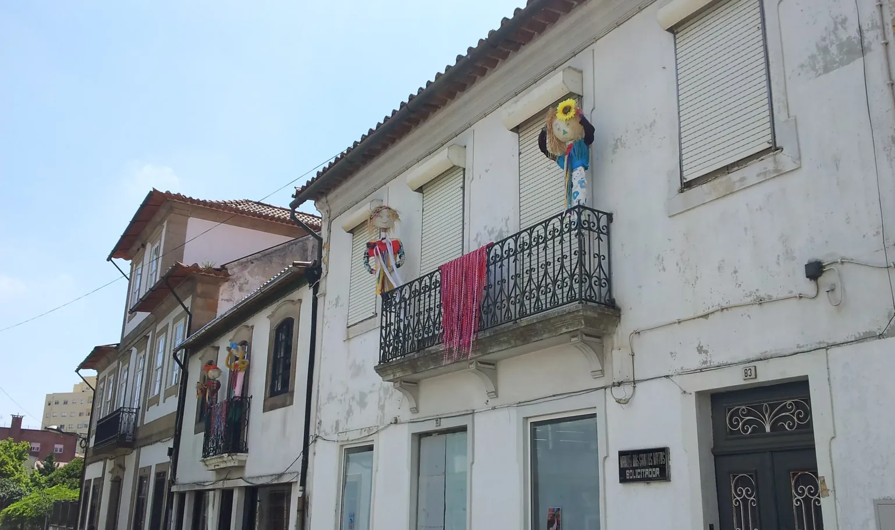
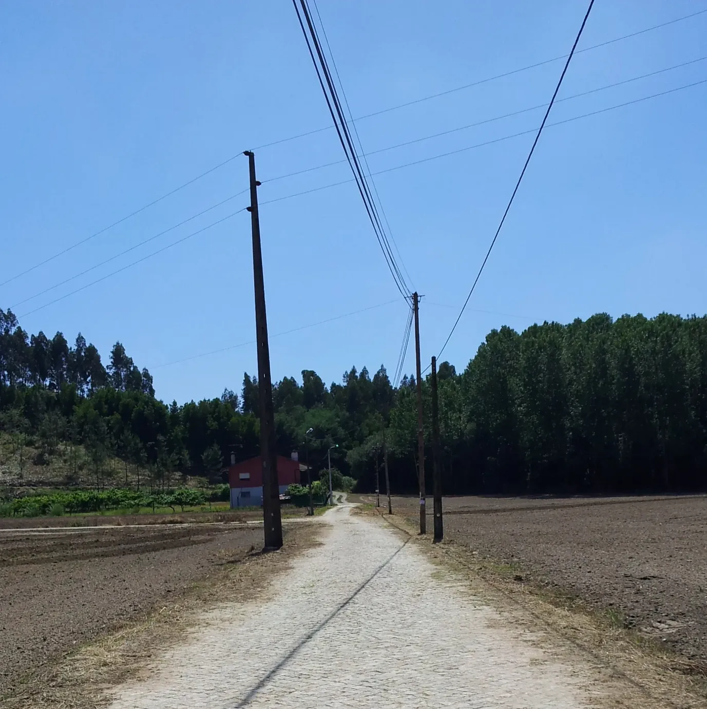
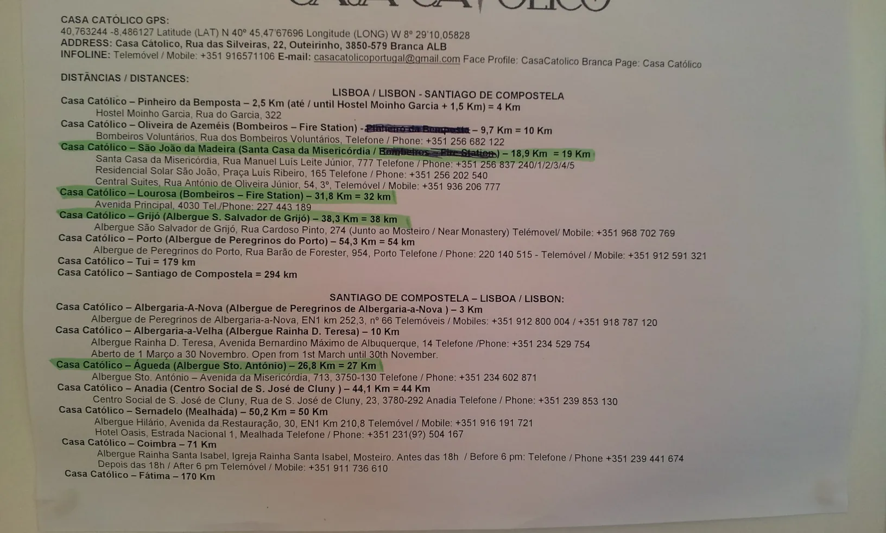
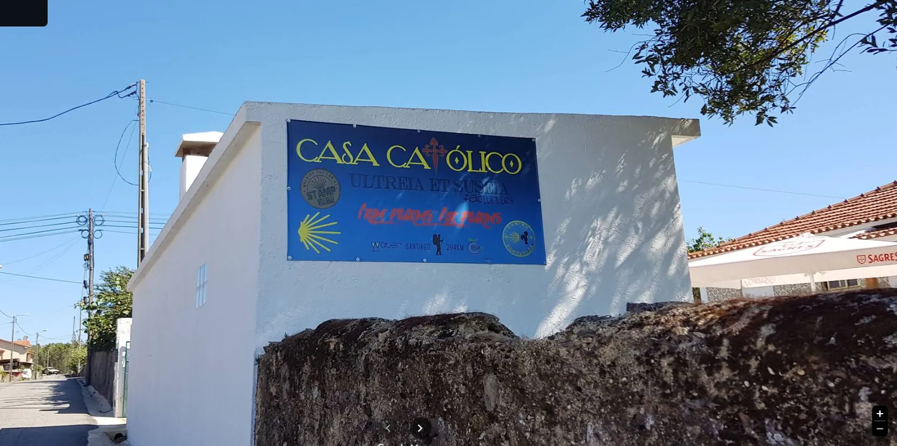

## Santiago de Compostela 👣 → Fátima 2019

### Etappe-09: Grijó → (*Albergaria-a-Nova*) Branca-Outeirinho ( 38,7 Km )
**21 Juni 2019** 👣  

### Algures por aqui 

**5 minutos para o meio dia**  
- Bom dia!  Já servem? 
- Só mais uns minutos. 
- Então uma cerveijinha e eu espero
..., ... .

**A melhor feijoada de frutos do mar que comi na minha vida** 

Google Maps Foto von Eduardo Torturici

---

  

🗺️

 🇬🇧 🇪🇸 🇵🇹 🇩🇪 🥾

---

↪ [Etappe-10_Branca_Agueda](Etappe-10_Branca_Agueda.md)

🔁  [Caminho-de-Fatima_Etapas](Camino-del-Salvador/Caminhos-de-Fatima/2_Santiago_Fatima_2019/Caminho-de-Fatima_Etapas.md)

 ...→