## Santiago de Compostela 👣 → Fátima 2019

### Etappe-10: Branca → Águeda ( 24,9 Km)
**22 Juni 2019** 👣  

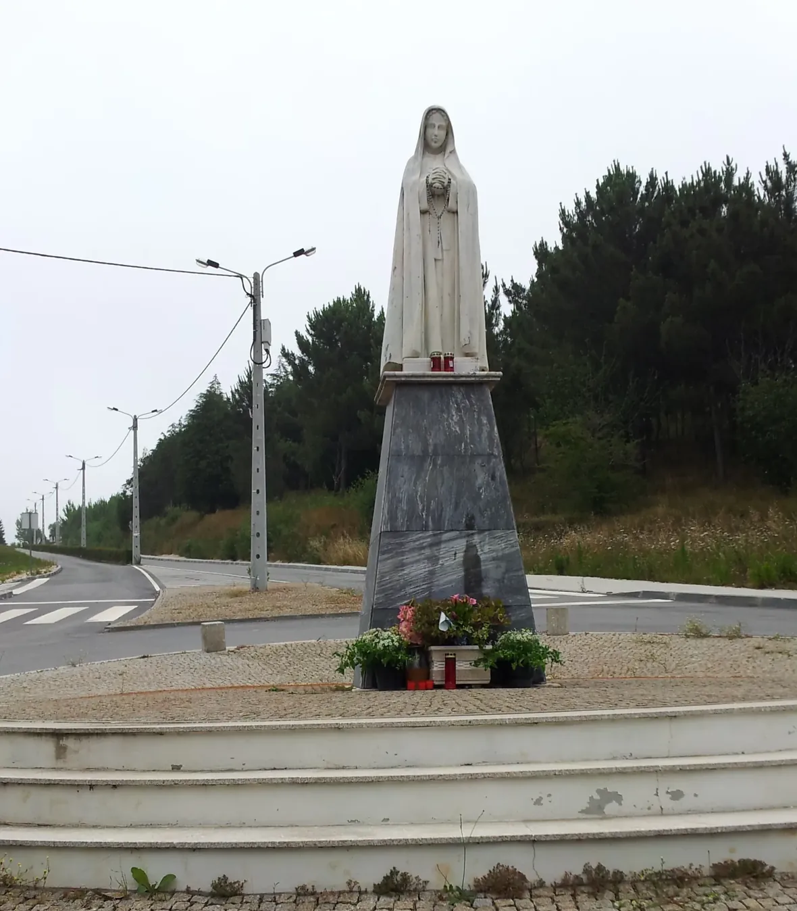

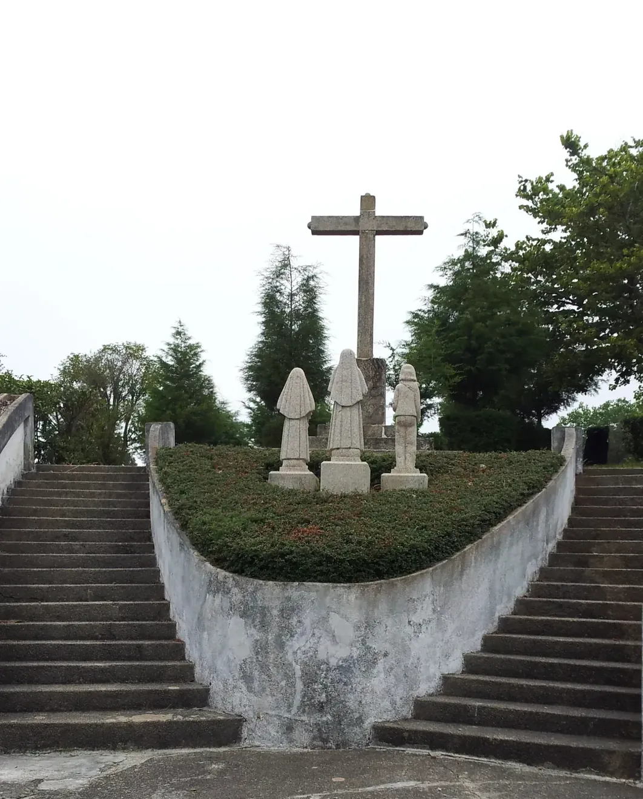

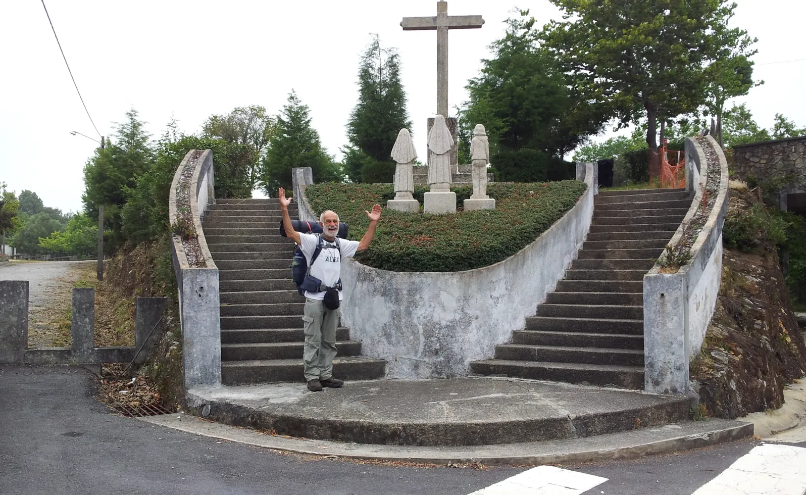

Er zog seine Wanderstiefel an, packte seinen Rucksack und sagte zu seiner Familie: „Ich gehe für eine Weile weg.“ Er war fünf Monate lang unterwegs und setzte anschließend seine Pilgerreisen fort.

Se puso las botas de montaña, preparó la mochila y  les dijo a sus familiares: «Me voy por un tiempo». Estuvo de viaje durante cinco meses y después continuó sus rutas de peregrinación.

He put on his hiking boots, packed his rucksack and  told his family, ‘I’m off for a while.’ He was away for five months and then continued on his pilgrimage routes. 

Calçou as botas de montanha, preparou a mochila e disse à família: «Vou-me embora por uns tempos». Esteve em viagem durante cinco meses e, depois, continuou os seus percursos de peregrinação. 

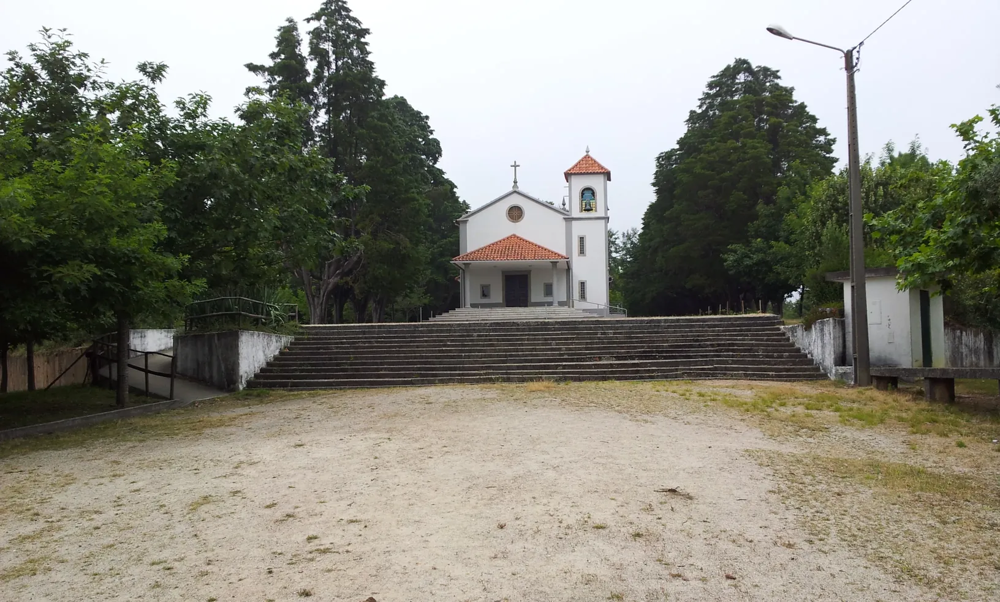

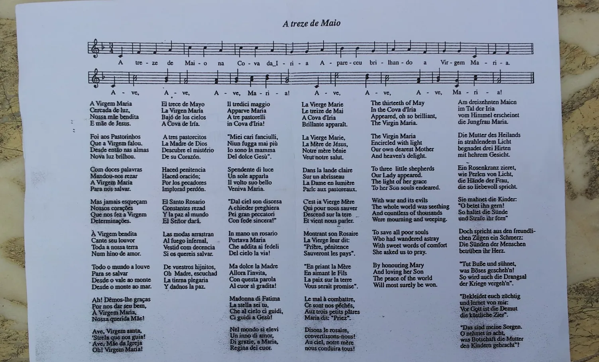

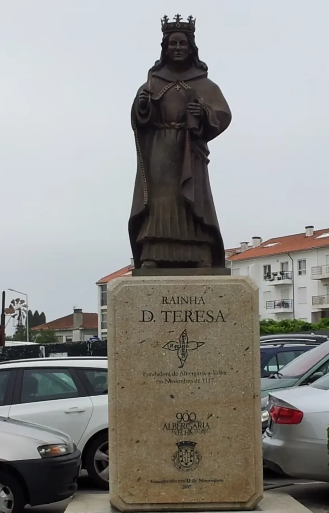

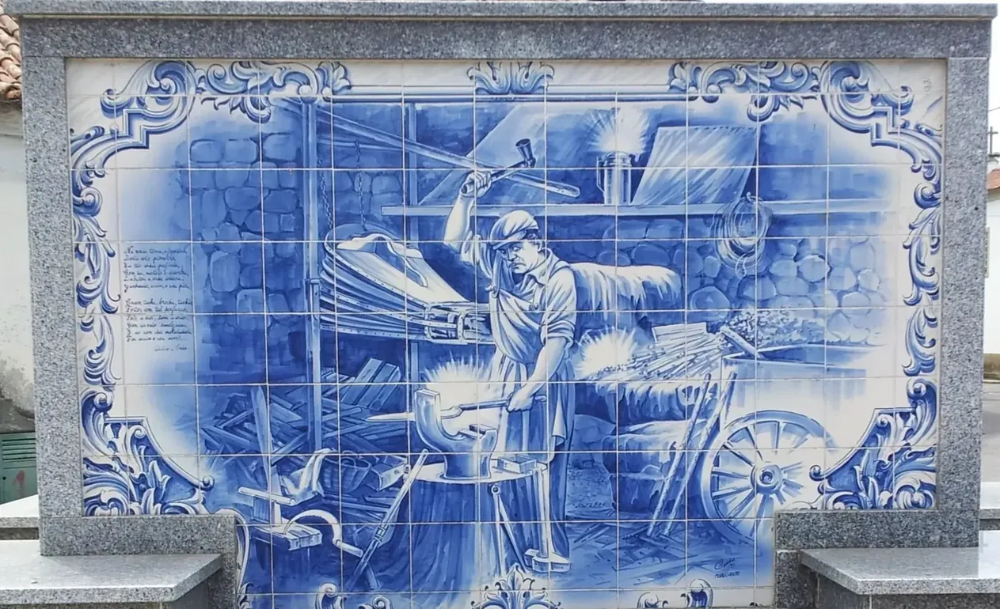

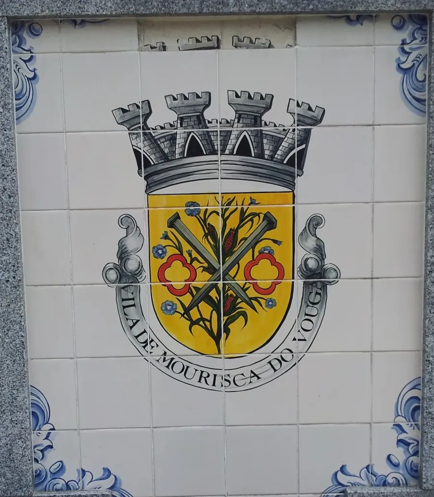

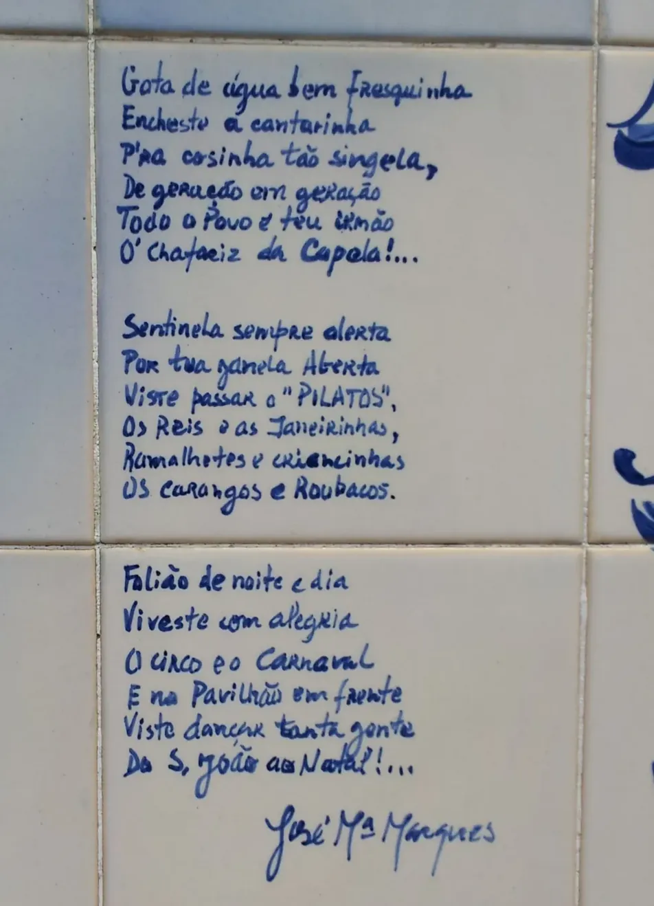

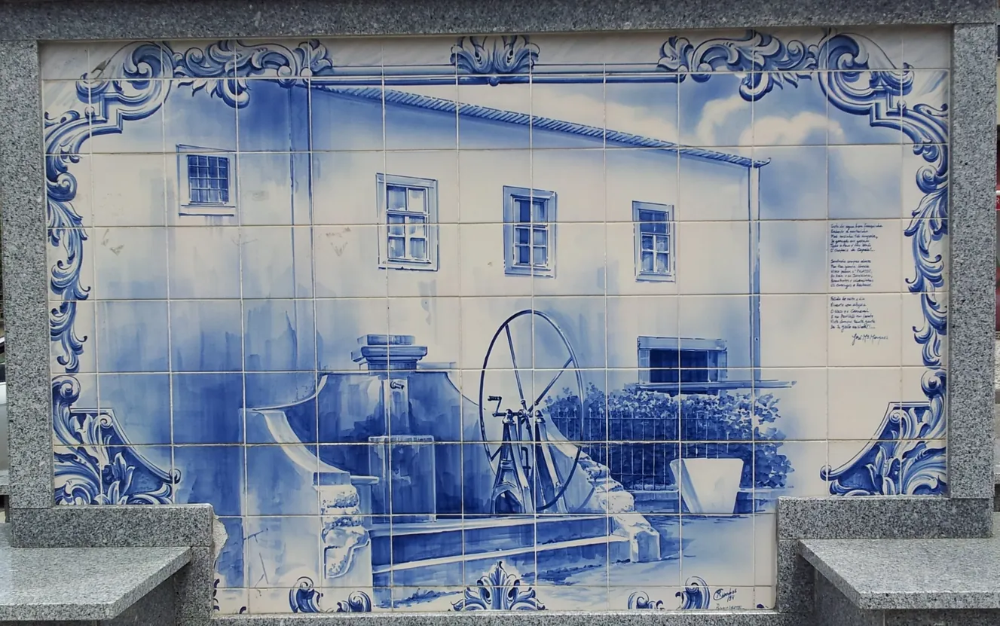

🇩🇪 Wo hatte ich nur meinen Gedanken? Ich kann mich an gar nichts aus meinem Aufenthalt in der Herberge erinnern.

🇵🇹 Onde é que eu tinha a minha mente? Não me lembro de absolutamente nada da minha estadia no albergue.

🇪🇸 ¿En qué lugar estaba mi mente? No recuerdo absolutamente nada de mi estancia en el albergue.

🇬🇧 Where on earth were my thoughts? I can’t remember a single thing about my stay at the hostel.

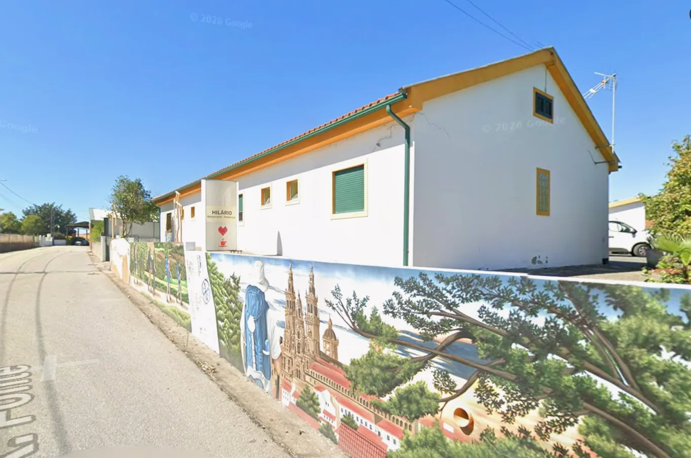
**Google Maps Foto ↑**

---

  

🗺️

 🇬🇧 🇪🇸 🇵🇹 🇩🇪 🥾

---

↪ [Etappe-11_Agueda_Sernadelo](Etappe-11_Agueda_Sernadelo.md)

🔁  [Caminho-de-Fatima_Etapas](Camino-del-Salvador/Caminhos-de-Fatima/2_Santiago_Fatima_2019/Caminho-de-Fatima_Etapas.md)

 ...→