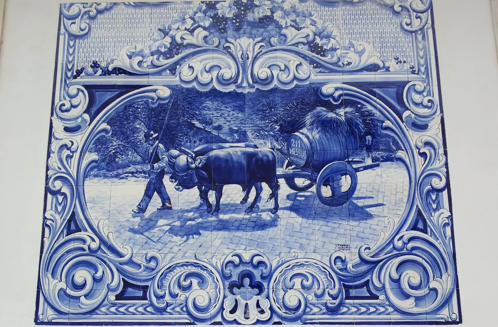
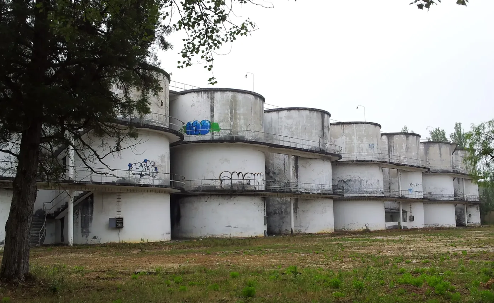
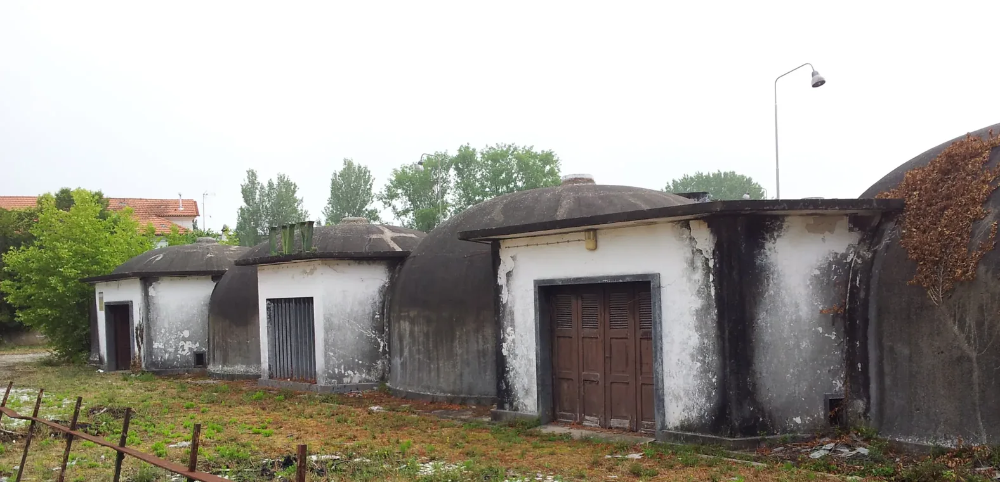
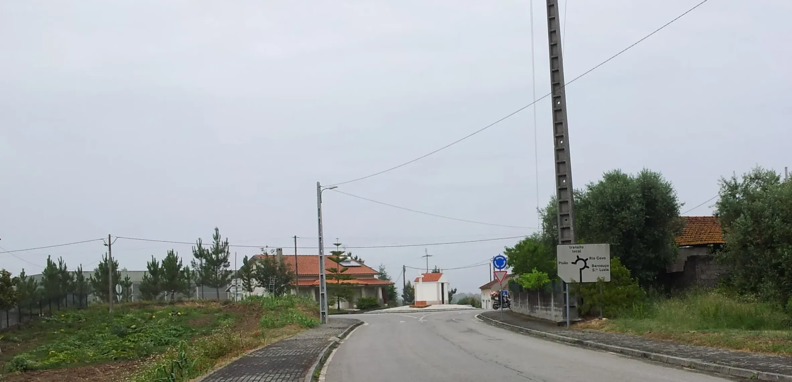
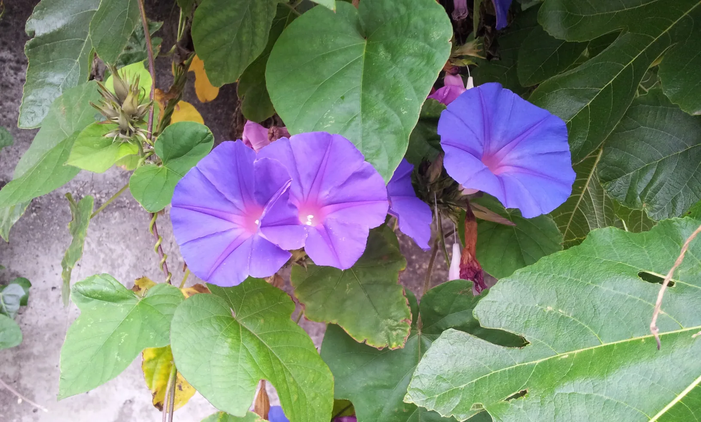
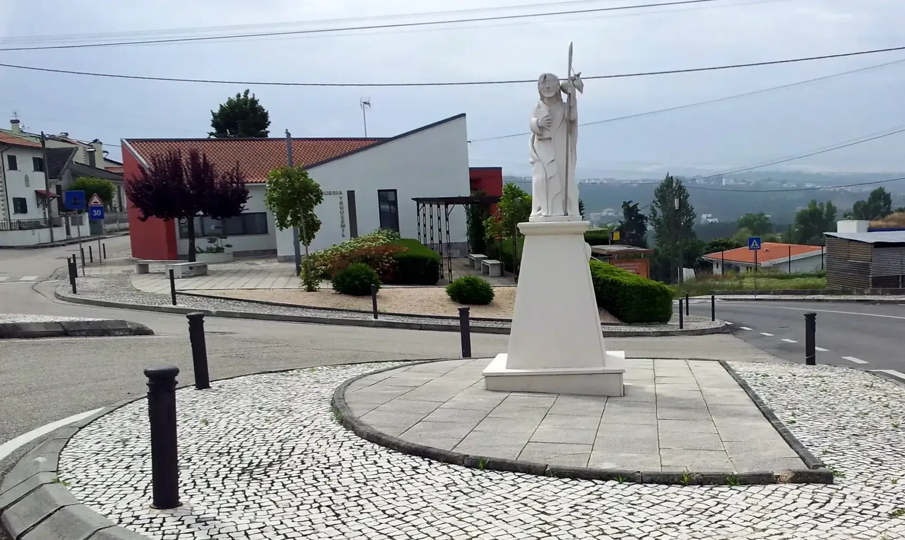
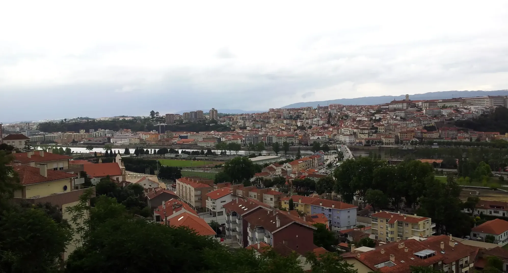
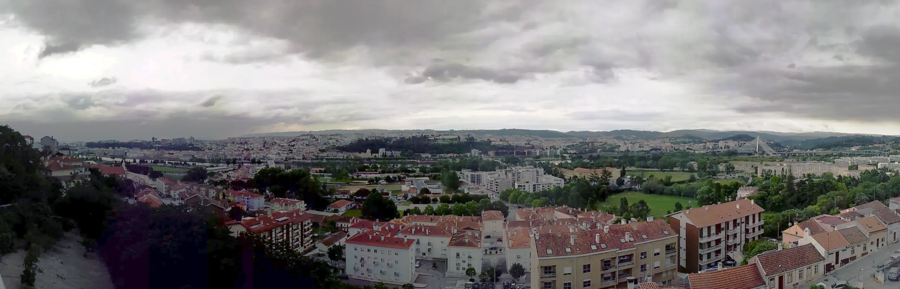

## Santiago de Compostela 👣 → Fátima 2019

### Etappe-12: Sernadelo → Coimbra  ( 24,8 Km)
**24 Juni 2019** 👣  

O Jantar no Restaurante tradicional: Depois de caminhar quase 1000 Kilometros estava com fome e deixei o prato limpo. A Senhora perguntou se não foi  suficiente. Sim fiquei bem satisfeito, mas antigamente em Portugal quem deixava o prato limpo era porque serviram pouco. Na Alemanha quem deixa o prato limpo respeita o comer e quem o cultivou.

Aqui neste restaurante, tambem se não estragava nada, porque tudo era aproveitado como ração para os animais na quinta.   

---

  

🗺️

 🇬🇧 🇪🇸 🇵🇹 🇩🇪 🥾

---

↪ [Etappe-13_Coimbra_Rabaçal](Etappe-13_Coimbra_Rabaçal.md)

🔁  [Caminho-de-Fatima_Etapas](Camino-del-Salvador/Caminhos-de-Fatima/2_Santiago_Fatima_2019/Caminho-de-Fatima_Etapas.md)

 ...→