## Santiago de Compostela 👣 → Fátima 2019

###    
**28 Juni 2019** 👣  

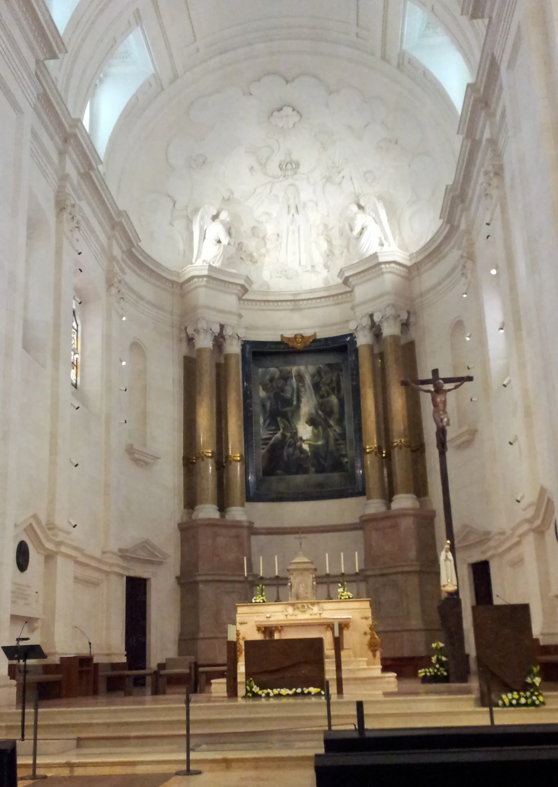

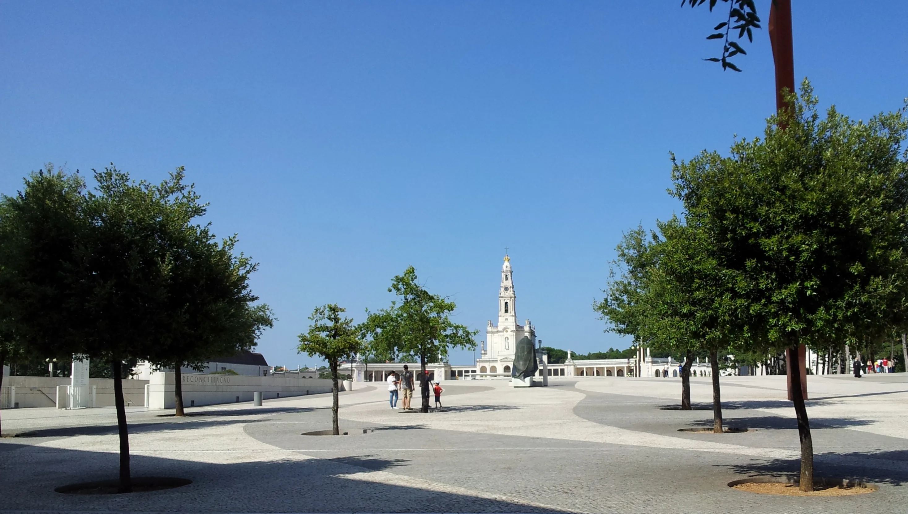

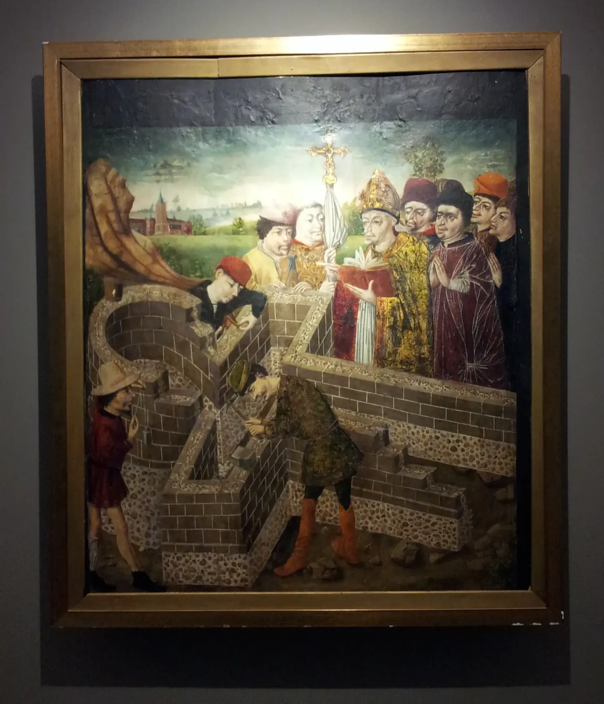

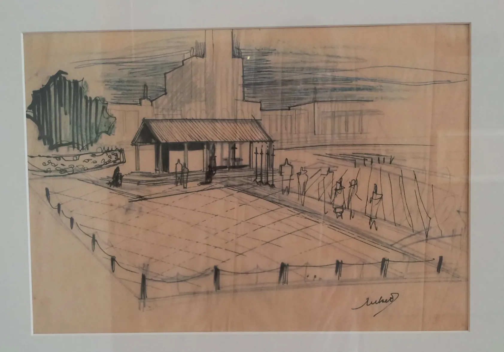

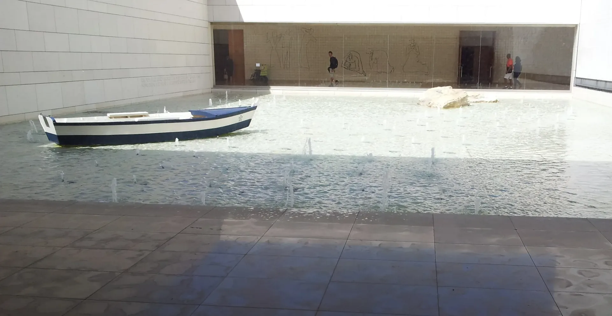

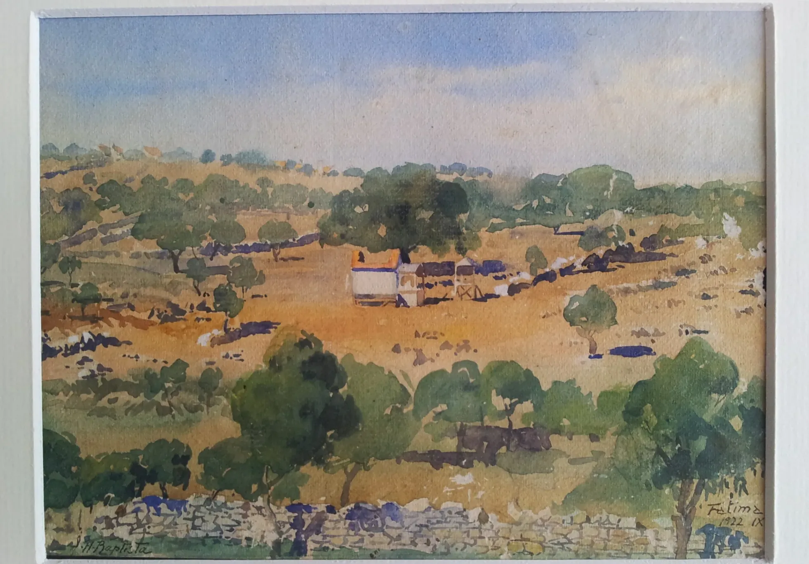

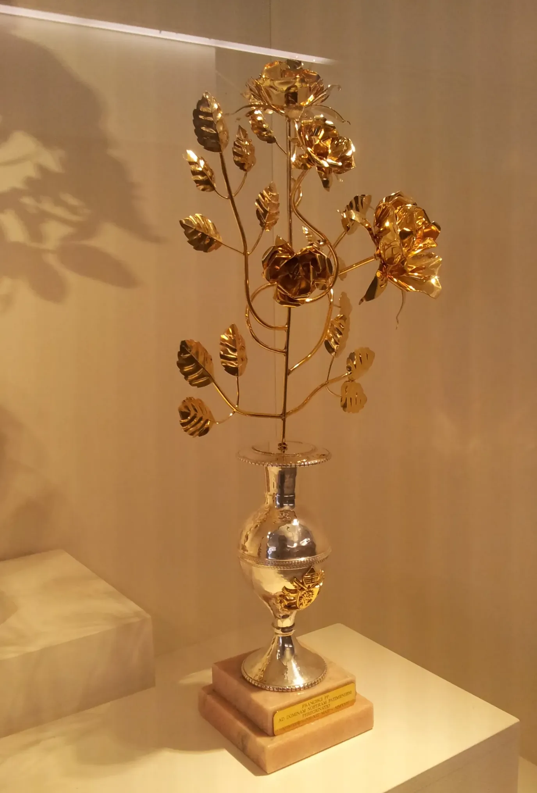

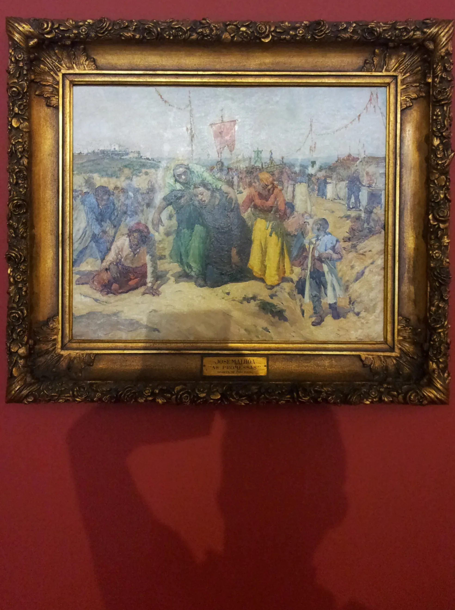

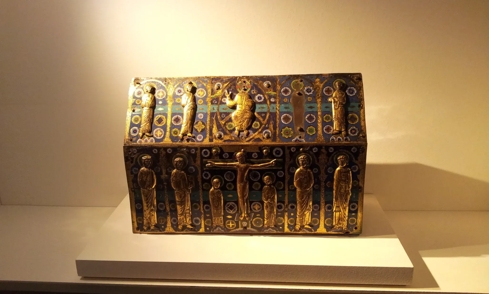

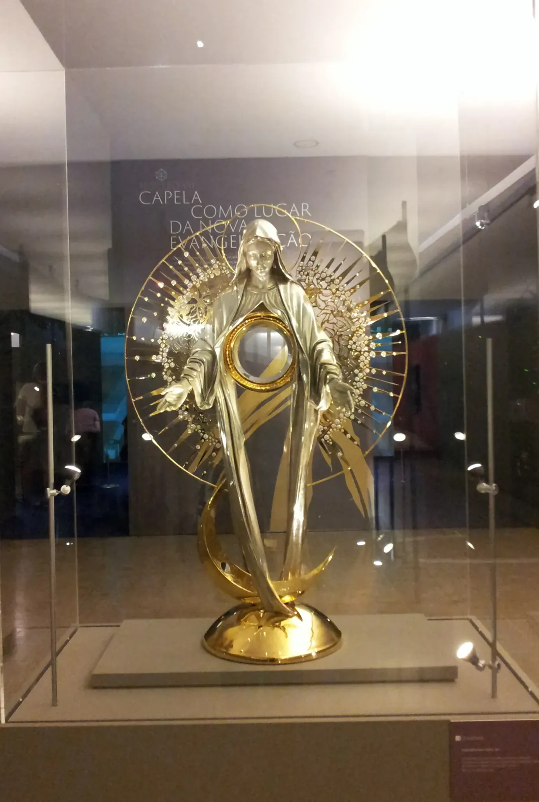

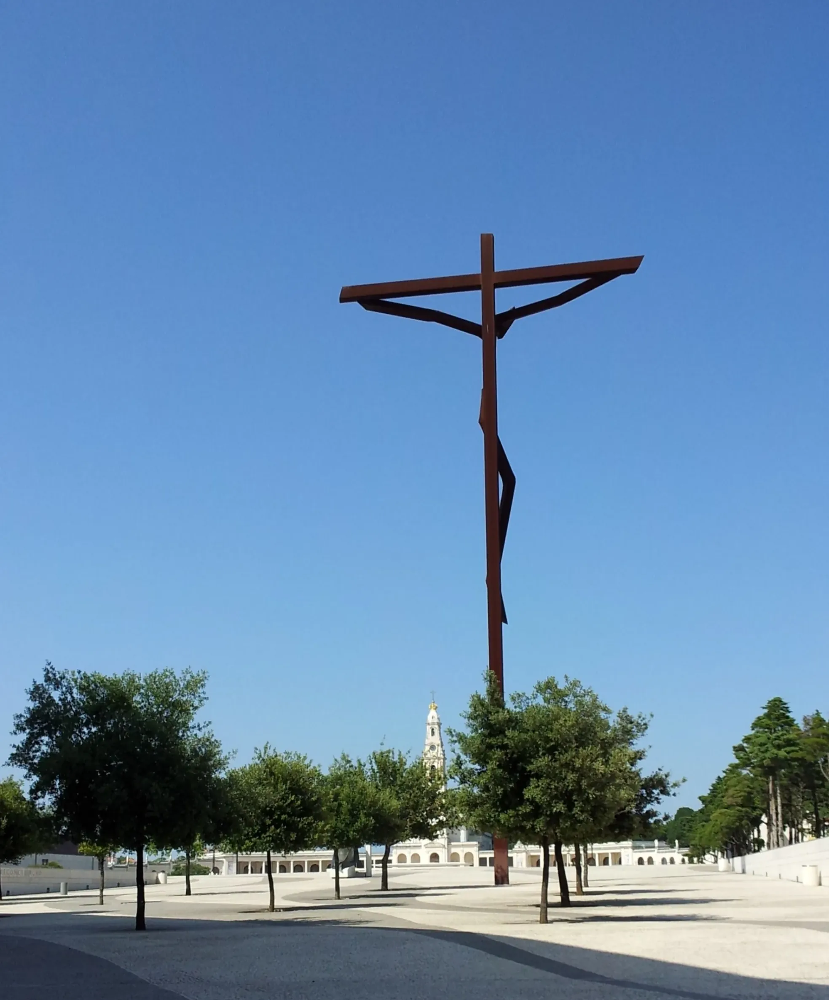

---

  

🗺️

 🇬🇧 🇪🇸 🇵🇹 🇩🇪 🥾

---

↪ [Etappe-01_Santiago-de-Compostela_Padron](Etappe-01_Santiago-de-Compostela_Padron.md)

🔁  [Caminho-de-Fatima_Etapas](Camino-del-Salvador/Caminhos-de-Fatima/2_Santiago_Fatima_2019/Caminho-de-Fatima_Etapas.md)

 ...→